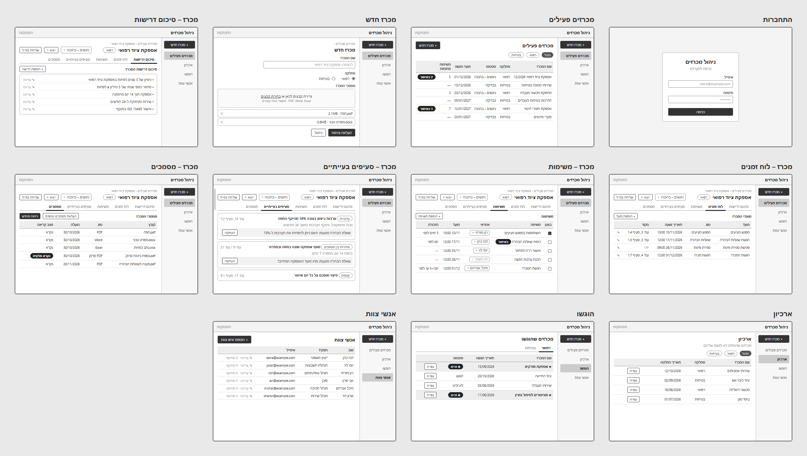
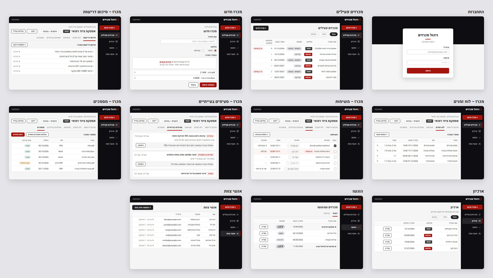
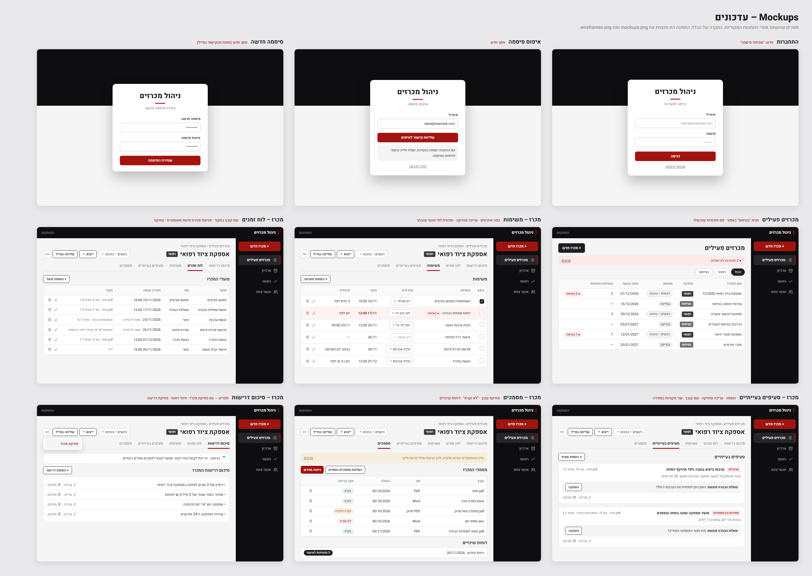
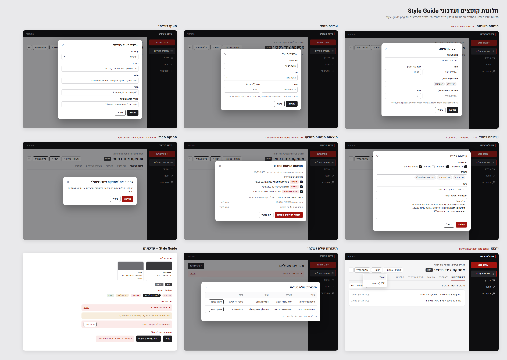
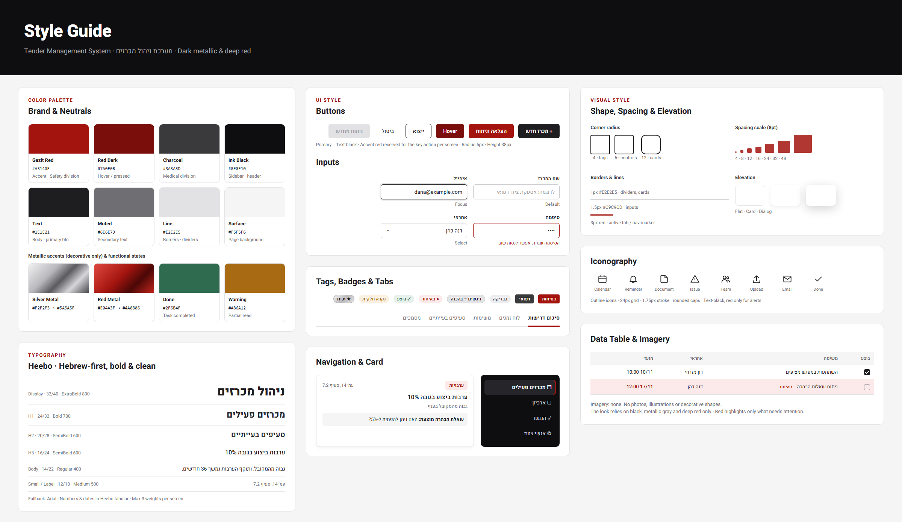

# Design (UI / UX)

> עיצוב האפליקציה, בשני חלקים: ה-**מסכים** (Screens) וה-**Style Guide**. המסמך מתבסס על ה-PRD ועל שלוש תמונות הייחוס שבתיקיית `spec/`. ה-Wireframes קובעים את המבנה והתוכן, ה-Style Guide קובע את השפה העיצובית, וה-Mockups מציגים את המראה הסופי.
>
> **עדכונים אחרי התמונות:** המשתמשת אישרה כמה שינויים אחרי שהתמונות המקוריות הוכנו. השינויים מוצגים בשתי תמונות עדכון: `mockups-updates.png` ו-`mockups-dialogs.png`. במקרה של הבדל, תמונות העדכון והטקסט במסמך הזה מנצחים את `wireframes.png`, את `mockups.png` ואת `style-guide.png`. השינויים העיקריים:
> - תגית "בטיחות" באפור ולא באדום.
> - כמה אחראים למשימה.
> - פעולות מחיקה ועריכה נוספות.
> - חלונות ומצבים שאין להם תמונה (סעיף "חלונות ומצבים נוספים").

## 1. Screens – מסכי האפליקציה

### Wireframes (מבנה ופריסה)

### Mockups (המראה הסופי)

### Mockups – עדכונים (מנצחים את התמונות שלמעלה)
מסכים שהשתנו: התחברות עם "שכחתי סיסמה", איפוס סיסמה, סיסמה חדשה, מכרזים פעילים (תגית "בטיחות" באפור ופס תזכורות שנכשלו), ולשוניות המכרז עם עריכה, מחיקה, כמה אחראים, שמות קבצים במקור ודוחות שינויים.

חלונות קופצים ועדכוני Style Guide: הוספת משימה, עריכת מועד, סעיף בעייתי, שליחה במייל, תוצאות הניתוח מחדש, מחיקה, ייצוא, תזכורות שלא נשלחו, תגיות מחלקה, פסי התראה והודעות קצרות.

### מבנה משותף (App Shell)
כל המסכים, חוץ מ"התחברות", בנויים על אותה מסגרת:
- **פס עליון** (Ink Black): שם המערכת **"ניהול מכרזים"** מימין, עם סימן אדום קצר לפניו. הקישור **"התנתקות"** בצד שמאל, באפור.
- **תפריט צד מימין** (Ink Black):
  - בראשו כפתור אדום **"+ מכרז חדש"**.
  - מתחתיו חמישה פריטי ניווט, כל אחד עם אייקון קווי: **"לוח בקרה"**, **"מכרזים פעילים"**, **"ארכיון"**, **"הוגשו"**, **"אנשי צוות"**.
  - הפריט הפעיל מקבל רקע כהה מעט יותר, טקסט לבן מודגש ופס אדום בצד ימין.
- **אזור תוכן** על רקע Surface (`#F5F5F6`). טבלאות וכרטיסים מוצגים על רקע לבן.

### רשימת המסכים

#### התחברות
- **מטרת המסך:** כניסה למערכת עם אימייל וסיסמה.
- **מבנה ותוכן:**
  - בלי App Shell. הרקע חצוי: שחור בחלק העליון ו-Surface בחלק התחתון.
  - במרכז כרטיס לבן עם צל מוגבה (Dialog). בראש הכרטיס הכותרת **"ניהול מכרזים"** וקו אדום קצר מתחתיה, ואחריהם תת-הכותרת **"כניסה למערכת"**.
  - שדות **"אימייל"** ו**"סיסמה"**, וכפתור אדום ברוחב מלא **"כניסה"**.
  - מתחת לכפתור, קישור Ghost קטן באפור: **"שכחתי סיסמה"**.
- **פעולות וניווט:** אחרי התחברות מוצלחת עוברים ל"לוח בקרה". "שכחתי סיסמה" עובר למסך "איפוס סיסמה".

#### איפוס סיסמה (שני מסכים)
- **מבנה:** אותה מסגרת כמו מסך ההתחברות: רקע חצוי וכרטיס במרכז.
- **"איפוס סיסמה":** שדה "אימייל" וכפתור אדום **"שליחת קישור לאיפוס"**. אחרי השליחה מוצגת ההודעה **"אם הכתובת רשומה במערכת, נשלח אליה קישור לאיפוס הסיסמה."**. מתחת לכפתור קישור **"חזרה לכניסה"**.
- **"סיסמה חדשה"** (נפתח מהקישור במייל): שדות "סיסמה חדשה" ו"אימות סיסמה", וכפתור אדום **"שמירת הסיסמה"**. אחרי השמירה עוברים ל"לוח בקרה".

#### לוח בקרה (מסך ראשי)
> אין למסך הזה תמונה. הוא בנוי מאותם רכיבים של ה-Style Guide: כרטיסים לבנים, מספרים גדולים, כפתורים ו-Badges. האדום שמור רק למשימות באיחור.
- **מטרת המסך:** תמונת מצב במבט אחד, במספרים ובגרפים פשוטים, כמעט בלי טקסט, וכפתורים למעבר לשאר המערכת.
- **מבנה ותוכן (מלמעלה למטה):**
  - כותרת **"לוח בקרה"**.
  - **שורת כפתורי מעבר:** **"+ מכרז חדש"** (Accent), ואחריו כפתורי Secondary עם אייקון: **"מכרזים פעילים"**, **"ארכיון"**, **"הוגשו"**, **"אנשי צוות"**.
  - **שורת מדדים מרכזיים:** כרטיסים לבנים, בכל אחד מספר גדול (Display) ותווית קצרה מתחתיו.
    - **"הגשות פתוחות"**: מספר המכרזים הפעילים.
    - **"משימות באיחור"**: המספר באדום כשהוא גדול מ-0, ובשחור כשאין איחורים.
    - **"משימות בשבוע הקרוב"**: משימות פתוחות שמועדן בשבעת הימים הקרובים.
  - **"מכרזים לפי סטטוס":** חמישה כרטיסים קטנים, בכל אחד מספר ו-Badge הסטטוס: "בבדיקה", "ניגשים – בהכנה", "הוגש", "★ זכינו", "לא זכינו".
  - **שני גרפי עמודות פשוטים**, זה לצד זה, כל אחד בכרטיס לבן:
    - **"הגשות בחודשים הקרובים"**: 6 חודשים קדימה, מהחודש הנוכחי. בכל חודש, מספר המכרזים הפעילים שמועד ההגשה שלהם באותו חודש.
    - **"הגשות שבוצעו בשנה האחרונה"**: 12 חודשים אחורה, עד החודש הנוכחי. בכל חודש, מספר המכרזים שהוגשו באותו חודש.
    - עמודות בצבע Text (`#1E1E21`). המספר מופיע מעל כל עמודה, ושם החודש מתחתיה (למשל "נוב׳ 26"). בלי צירים, בלי רשת ובלי מקרא. חודש בלי הגשות מוצג עם "0" ובלי עמודה.
- **פעולות וניווט:**
  - כל כפתור מעבר פותח את המסך שלו.
  - לחיצה על "הגשות פתוחות", "בבדיקה" או "ניגשים – בהכנה" פותחת את "מכרזים פעילים". לחיצה על "הוגש", "זכינו" או "לא זכינו" פותחת את "הוגשו".
  - לחיצה על "משימות באיחור" פותחת את "מכרזים פעילים", שבו מסומנים המכרזים עם האיחורים.
- **מצב ריק:** כשאין עדיין מכרזים, המדדים מציגים 0, ומעל שורת המדדים מופיעה ההודעה הקצרה "עדיין אין מכרזים." עם הכפתור "+ מכרז חדש".
- **נייד:** הכפתורים עוברים לכמה שורות, וכרטיסי המדדים מוצגים שניים בשורה. הגרפים מוצגים אחד מתחת לשני, ברוחב מלא.

#### מכרזים פעילים
- **מטרת המסך:** תמונת מצב של כל המכרזים בסטטוס "בבדיקה" ו"ניגשים – בהכנה".
- **מבנה ותוכן:**
  - כותרת **"מכרזים פעילים"** מימין, וכפתור **"+ מכרז חדש"** (Primary שחור) משמאל.
  - שורת מסנני מחלקה בצורת Pills: **"הכול"**, **"רפואי"**, **"בטיחות"**. המסנן הפעיל מלא בשחור.
  - טבלה עם העמודות: שם המכרז | מחלקה (תגית מחלקה) | סטטוס (Badge) | מועד הגשה | משימות פתוחות | עמודת איחורים.
  - בעמודת האיחורים מוצג Badge אדום בהיר, כמו **"● 2 באיחור"**, ורק כשיש משימות באיחור.
  - **התראה על תזכורות שנכשלו:** כשיש תזכורות שנכשלו בשליחה, מוצג מעל הטבלה פס התראה ברקע Red Tint עם טקסט אדום: **"● 2 תזכורות לא נשלחו"**, וקישור **"פרטים"**. הקישור פותח חלון עם הרשימה: מכרז, משימה, נמען וסיבה, וכפתור **"סימון כטופל"** לכל שורה.
- **פעולות וניווט:**
  - סינון לפי מחלקה.
  - לחיצה על שורה פותחת את מסך המכרז, בלשונית "סיכום דרישות".
  - "+ מכרז חדש" עובר למסך "מכרז חדש".

#### מכרז חדש
- **מטרת המסך:** יצירת מכרז, סיווג למחלקה והעלאת המסמכים לניתוח.
- **מבנה ותוכן:**
  - Breadcrumb **"מכרזים פעילים ›"** וכותרת **"מכרז חדש"**.
  - שדה **"שם המכרז"**, עם Placeholder **"לדוגמה: אספקת ציוד רפואי"**.
  - בחירת **"מחלקה"** בכפתורי Radio: **"רפואי"** / **"בטיחות"**. הכפתור הנבחר באדום.
  - אזור **"מסמכי המכרז"**: Dropzone עם מסגרת מקווקוות והטקסט **"גרירת קבצים לכאן או בחירת קבצים"**. "בחירת קבצים" מודגש באדום וקו תחתון. מתחת לטקסט הערה קטנה: **"PDF, Word, Excel · אפשר כמה קבצים"**.
  - רשימת הקבצים שנבחרו. לכל קובץ שורה עם שם וגודל, וכפתור **✕** להסרה.
  - בתחתית: כפתור אדום **"העלאה וניתוח"** וכפתור Secondary **"ביטול"**.
- **פעולות וניווט:**
  - "העלאה וניתוח" שומר את המכרז, מתחיל את הניתוח ועובר למסך המכרז.
  - "ביטול" חוזר ל"מכרזים פעילים".

#### מסך מכרז (חמש לשוניות)
חמשת המסכים הבאים חולקים **ראש מסך משותף**:
- Breadcrumb **"<הרשימה שממנה נכנסת> › <שם המכרז>"**: "מכרזים פעילים", "ארכיון" או "מכרזים שהוגשו". הקישור מחזיר לאותה רשימה.
- שם המכרז ככותרת H1, ולידו תגית מחלקה.
- משמאל: בחירת סטטוס (Select, למשל **"ניגשים – בהכנה"**), כפתור **"ייצוא ▾"**, כפתור **"שליחה במייל"**, וכפתור אייקון **"⋯"** שפותח תפריט עם **"מחיקת מכרז"** (בטקסט אדום).
- **מצב ניתוח:** בזמן ניתוח מוצג מתחת ללשוניות פס ברקע Surface עם סמל טעינה והטקסט **"בניתוח… זה יכול לקחת כמה דקות. אפשר לעבור למסכים אחרים בינתיים."**. אם הניתוח נכשל, מוצג פס ברקע Red Tint: **"הניתוח לא הצליח. הקבצים נשמרו."** וכפתור **"ניסיון חוזר"**. אם חלק מהקבצים נקראו חלקית, מוצג פס ברקע כתום בהיר: **"חלק מהמסמכים נקראו חלקית, ולכן הניתוח עלול להיות חלקי."** וקישור ללשונית "מסמכים".
- מתחת לכותרת, שורת לשוניות: **"סיכום דרישות"**, **"לוח זמנים"**, **"משימות"**, **"סעיפים בעייתיים"**, **"מסמכים"**. הלשונית הפעילה בטקסט מודגש, עם קו תחתון אדום בעובי 3px.

**פעולות משותפות:**
- שינוי הסטטוס. בחירה ב"לא ניגשים" מעבירה את המכרז לארכיון, ובחירה ב"הוגש", "זכינו" או "לא זכינו" מעבירה אותו ל"הוגשו".
- "ייצוא" פותח בחירה בין PDF ל-Word.
- "שליחה במייל" פותח חלון (Dialog) לבחירת התוכן והנמען.

#### מכרז – סיכום דרישות
- **מטרת המסך:** הבנה מהירה של דרישות המכרז.
- **מבנה ותוכן:** כותרת משנה **"סיכום דרישות המכרז"**, וכפתור קטן **"+ הוספת דרישה"**. מתחתיהן כרטיס לבן עם רשימת דרישות. כל דרישה בשורה עם תבליט, ובקצה השמאלי הקישורים **"✎ עריכה · 🗑 מחיקה"** באפור, כמו במסך "אנשי צוות".
- **פעולות וניווט:** הוספת דרישה, עריכה ומחיקה, ומעבר בין הלשוניות. עריכה של דרישה נעשית בתוך השורה (Inline): הטקסט הופך לשדה, עם "שמירה" ו"ביטול".

#### מכרז – לוח זמנים
- **מטרת המסך:** צפייה בכל מועדי המכרז ועריכתם.
- **מבנה ותוכן:** כותרת משנה **"מועדי המכרז"** וכפתור **"+ הוספת מועד"**. מתחתיהן טבלה עם העמודות מועד | סוג | תאריך ושעה | מקור | פעולות (✎ 🗑).
  - בעמודת "מקור" מופיעה הפניה למסמך, עם שם הקובץ (למשל **"חוזה.pdf · עמ' 3, סעיף 1.4"**). במועד שהוזן ידנית מופיע **"ידני"**, ובפגישת סגירת פינות שנוצרה אוטומטית מופיע **"אוטומטי (3 ימי עבודה לפני ההגשה)"**.
  - מועד בלי שעה מוצג כתאריך בלבד, עם הערה Muted קטנה **"שעה לא צוינה"**.
- **פעולות וניווט:** הוספה, עריכה ומחיקה של מועד, בחלון "מועד".

#### מכרז – משימות
- **מטרת המסך:** שיוך משימות לאנשי צוות ומעקב אחר ביצוען.
- **מבנה ותוכן:**
  - כותרת משנה **"משימות"** וכפתור **"+ הוספת משימה"**.
  - טבלה עם העמודות בוצע (Checkbox) | משימה | אחראים | מועד | תזכורת | פעולות (✎ 🗑).
  - **אחראים:** Select עם בחירה מרובה מרשימת אנשי הצוות. כשנבחר אחראי אחד מוצג שמו, וכשנבחרו כמה מוצג השם הראשון ו-"+1" (למשל **"דנה כהן +1"**).
  - משימה שלא שויכה מציגה Select ריק עם הטקסט **"לא משויך"**.
  - בעמודת "תזכורת" מוצג תזמון התזכורת (למשל **"3 ימים לפני"**, **"יום לפני"**, **"יום ו-3 ש׳ לפני"**, **"בבוקר יום הפגישה"**). במשימה רגילה מוצג המועד שנבחר (למשל **"12/11 08:00"**). כשאין תזכורת מוצג **"—"**.
  - **משימה באיחור:** כל השורה מקבלת רקע אדמדם בהיר, ליד שם המשימה מופיע Badge **"● באיחור"**, ותאריך המועד מוצג באדום מודגש.
  - **משימה שבוצעה:** ה-Checkbox מלא בשחור, עם סימן ✓ לבן.
- **פעולות וניווט:**
  - סימון "בוצע" וביטולו.
  - בחירת אחראים.
  - "+ הוספת משימה" ו-✎ פותחים את חלון "משימה". 🗑 מוחק אחרי אישור.

#### מכרז – סעיפים בעייתיים
- **מטרת המסך:** סקירה של הסעיפים הבעייתיים ושאלות ההבהרה המוצעות.
- **מבנה ותוכן:** כותרת משנה **"סעיפים בעייתיים"** וכפתור קטן **"+ הוספת סעיף"**. מתחתיהן רשימה נגללת של כרטיסים לבנים. כל כרטיס כולל:
  - **שורה עליונה:** תגית קטגוריה באדום בהיר (למשל **"ערבויות"**, **"סתירות בין מסמכים"**, **"קנסות"**), ואחריה כותרת הסעיף בטקסט מודגש. ההפניה למקור, עם שם הקובץ (למשל **"חוזה.pdf · עמ' 14, סעיף 7.2"**), מוצגת משמאל באפור. בסתירה בין מסמכים מוצגות כל ההפניות, מופרדות ב-" / ".
  - **הסבר קצר** בטקסט Muted.
  - **תיבה באפור בהיר** עם **"שאלת הבהרה מוצעת: ..."**, ובצד שלה כפתור קטן **"העתקה"**.
  - **בתחתית הכרטיס, משמאל:** **"✎ עריכה · 🗑 מחיקה"** באפור.
- **פעולות וניווט:** הוספה, עריכה ומחיקה של סעיף (בחלון "סעיף בעייתי"), העתקת שאלת ההבהרה וגלילה ברשימה.

#### מכרז – מסמכים
- **מטרת המסך:** ניהול הקבצים של המכרז והפעלת ניתוח מחדש.
- **מבנה ותוכן:**
  - כותרת משנה **"מסמכי המכרז"**, ומשמאל לה שני כפתורים: **"העלאת מסמכים נוספים"** (Secondary) ו**"ניתוח מחדש"** (אדום).
  - טבלה עם העמודות קובץ | סוג | הועלה | מצב קריאה | 🗑.
  - מצב הקריאה מוצג כ-Badge: **"נקרא"** בירוק, **"נקרא חלקית"** בכתום, **"לא נקרא"** באדום על Red Tint.
  - מתחת לטבלה, אזור **"דוחות שינויים"**: רשימה של הניתוחים החוזרים לפי תאריך (למשל **"ניתוח מחדש · 20/11/2026"**), וכל שורה פותחת את הדוח שלה. אם יש הצעות שעוד לא אושרו, מוצג לידן Badge **"3 ממתינות לאישור"**.
- **פעולות וניווט:**
  - העלאת קבצים נוספים.
  - מחיקת קובץ (🗑), אחרי אישור.
  - ניתוח מחדש. בסיומו נפתח החלון "תוצאות הניתוח מחדש".

#### ארכיון
- **מטרת המסך:** גישה למכרזים שהוחלט לא לגשת אליהם.
- **מבנה ותוכן:** כותרת **"ארכיון"** ותת-כותרת Muted **"מכרזים שהוחלט לא לגשת אליהם"**. מתחתיהן מסנני מחלקה (**"הכול"**, **"רפואי"**, **"בטיחות"**), וטבלה עם העמודות שם המכרז | מחלקה | תאריך החלטה | כפתור **"צפייה"**.
- **פעולות וניווט:** "צפייה" פותח את מסך המכרז עם כל הניתוח שלו.

#### הוגשו
- **מטרת המסך:** צפייה במכרזים שהוגשו, לפי מחלקה, ובתוצאותיהם.
- **מבנה ותוכן:**
  - כותרת **"מכרזים שהוגשו"**, ולשוניות מחלקה **"רפואי"** / **"בטיחות"** (באותו סגנון של לשוניות מסך המכרז).
  - טבלה עם העמודות שם המכרז | תאריך הגשה | סטטוס | כפתור **"צפייה"**.
  - הסטטוס מוצג כ-Badge: **"הוגש"** או **"לא זכינו"** בגוון אפור, ו**"★ זכינו"** בגוון כסוף-מתכתי.
  - **שורה של מכרז שזכינו בו:** שם המכרז מודגש עם ★ לפניו, והשורה ברקע אפור בהיר.
- **פעולות וניווט:** מעבר בין מחלקות, ו"צפייה" פותח את מסך המכרז.

#### אנשי צוות
- **מטרת המסך:** ניהול הרשימה הקבועה של אנשי הצוות.
- **מבנה ותוכן:** כותרת **"אנשי צוות"** וכפתור **"+ הוספת איש צוות"** (Primary). מתחתיהם טבלה עם העמודות שם | תפקיד | אימייל | פעולות (**"✎ עריכה · 🗑 מחיקה"**).
- **פעולות וניווט:** הוספה, עריכה ומחיקה של איש צוות.

### חלונות ומצבים נוספים
לחלונות האלה אין תמונה. הם בנויים מאותם רכיבים של ה-Style Guide: כרטיס לבן עם צל Dialog ופינות 12px, כותרת H2 מימין ו-✕ לסגירה משמאל, שדות עם תוויות מעל, ובתחתית הכפתור הראשי מימין ו"ביטול" (Secondary) משמאלו. בנייד הם נפתחים כמעט במלוא המסך.

- **"משימה"** (הוספה / עריכה): "שם המשימה", "מועד" (תאריך, ושעה לא חובה), "אחראים" (בחירה מרובה, לא חובה), ו"מועד תזכורת" (תאריך ושעה, לא חובה, ריק כברירת מחדל). אם השדה נשאר ריק, לא נשלחת תזכורת, ומתחתיו מוצגת הערה Muted **"בלי מועד תזכורת לא תישלח תזכורת"**. במשימה מאחד הסוגים הקבועים, במקום שדה מועד התזכורת מוצג תזמון התזכורות כטקסט Muted. הערה Muted מתחת: **"התזכורת תישלח לאחראים. אם אין אחראי, היא תישלח אלייך."**. כפתור ראשי: **"שמירה"**.
- **"מועד"** (הוספה / עריכה): "שם המועד", "סוג" (Select), "תאריך", "שעה" (לא חובה). כפתור ראשי: **"שמירה"**.
- **"סעיף בעייתי"** (הוספה / עריכה): "קטגוריה" (Select עם 8 הקטגוריות), "כותרת", "הסבר", "מקור" (טקסט חופשי), "שאלת הבהרה מוצעת". כפתור ראשי: **"שמירה"**.
- **אישור מחיקה** (לכל פריט, קובץ או מכרז): כותרת **"למחוק את <שם>?"**, שורת הסבר על מה שיימחק (במכרז: **"יימחקו גם כל הניתוח, המשימות, התזכורות והקבצים. אי אפשר לבטל את הפעולה."**), כפתור Accent **"מחיקה"** ו"ביטול".
- **"ייצוא ▾"**: תפריט קטן שנפתח מתחת לכפתור, עם שתי אפשרויות: **"Word"** ו-**"PDF (הדפסה)"**.
- **"שליחה במייל"**:
  - Checkboxes לבחירת החלקים: סיכום דרישות, לוח זמנים, משימות, סעיפים בעייתיים.
  - שדה **"נושא"** (ממולא מראש בשם המכרז), ותיבת טקסט גדולה **"תוכן המייל"**, שמתמלאת אוטומטית מהחלקים שנבחרו וניתנת לעריכה חופשית.
  - **"נמענים"**: בחירה מרובה מרשימת אנשי הצוות, ושדה להקלדת כתובות נוספות. כל נמען מוצג כתגית עם ✕.
  - כפתור Accent **"שליחה"**. אחרי השליחה מוצגת הודעה קצרה **"המייל נשלח ל-3 נמענים"**.
- **"תוצאות הניתוח מחדש"** (נפתח בסיום ניתוח חוזר, או מאזור "דוחות שינויים"):
  - **"נמצאו פריטים חדשים"**: רשימה מקובצת לפי סוג (דרישות, מועדים, משימות, סעיפים בעייתיים). לכל פריט Checkbox, מסומן כברירת מחדל.
  - **"לא נמצאו שוב בניתוח החדש"**: פריטים מהגרסה הקודמת, ב-Muted, עם ההערה **"כדאי לבדוק אם השתנו או הוסרו"**. לכל פריט קישור "מעבר לפריט". הם לא נמחקים אוטומטית.
  - כפתור Accent **"הוספת הפריטים שסומנו"**, וכפתור Secondary **"לא עכשיו"** (ההצעות נשמרות לאחר כך).
- **הודעות קצרות (Toast):** בתחתית המסך, על רקע Text עם טקסט לבן, למשל "נשמר" או "ההעתקה הצליחה". הודעת שגיאה מוצגת ברקע Red Tint עם טקסט אדום.

### מבנה הניווט
- **תפריט הצד** הוא הניווט הראשי בין חמשת אזורי המערכת: לוח בקרה, מכרזים פעילים, ארכיון, הוגשו ואנשי צוות. "לוח בקרה" הוא המסך הראשון אחרי ההתחברות. כפתור **"+ מכרז חדש"** זמין ממנו בכל מסך.
- **כניסה למסך מכרז:** אפשר להיכנס מכל רשימה של מכרזים (פעילים, ארכיון או הוגשו). בתוך מסך המכרז עוברים בין הלשוניות, וה-Breadcrumb מחזיר לרשימה שממנה נכנסת.
- **חלונות קופצים (Dialogs):** כל החלונות בסעיף "חלונות ומצבים נוספים" נפתחים מעל המסך הנוכחי, ולא כמסכים נפרדים.
- **מסכי ההתחברות ואיפוס הסיסמה** עומדים לבד. "התנתקות" בפס העליון מחזירה למסך ההתחברות.

---

## 2. Style Guide – השפה העיצובית

### Color Palette

| צבע / תפקיד | HEX | שימוש |
|-------------|-----|-------|
| Gazit Red (Accent) | `#A3140F` | הפעולה המרכזית במסך, סימון פריט פעיל (פס בתפריט, קו לשונית), שגיאות ואיחורים |
| Red Dark | `#7A0E0B` | Hover / Pressed של כפתור אדום |
| Red Tint | `#FBEAE9` | רקע ל-Badge "באיחור" ולתגיות קטגוריה. גוון בהיר ממנו לשורה באיחור |
| Charcoal | `#3A3A3D` | תגית "רפואי" |
| Slate | `#6E6E73` | תגית "בטיחות" (אפור בהיר יותר מ"רפואי", עם טקסט לבן, בניגודיות קריאה תקינה). מחליף את האדום שמופיע בתמונות |
| Ink Black | `#0E0E10` | פס עליון, תפריט צד, רקע עליון במסך ההתחברות |
| Text | `#1E1E21` | טקסט ראשי, כפתור Primary, מסנן פעיל, Checkbox מסומן |
| Muted | `#6E6E73` | טקסט משני, כותרות עמודות, הפניות למקור |
| Line | `#E2E2E5` | גבולות כרטיסים וטבלאות, קווי הפרדה |
| Surface | `#F5F5F6` | רקע אזור התוכן |
| White | `#FFFFFF` | כרטיסים, טבלאות, שדות |
| Silver Metal | `#F2F2F3` → `#5A5A5F` (Gradient) | Badge "★ זכינו" בלבד |
| Done | `#2F6B4F` | Badge "נקרא" (משימה שבוצעה מסומנת ב-Checkbox מלא) |
| Warning | `#A86A12` | Badge "נקרא חלקית" |

**כלל השימוש באדום:** אדום מסמן רק את הפעולה החשובה במסך ואת מה שדורש תשומת לב. כל שאר הממשק בשחור, באפורים ובלבן.

### Typography
- **גופן:** Heebo, מ-Google Fonts. גופן גיבוי: Arial. מספרים ותאריכים מוצגים גם הם ב-Heebo.
- **היררכיה:**

| רמה | גודל / גובה שורה | משקל | דוגמה |
|---|---|---|---|
| Display | 32/40 | ExtraBold 800 | שם המערכת במסך ההתחברות |
| H1 | 24/32 | Bold 700 | כותרת מסך ("מכרזים פעילים") |
| H2 | 20/28 | SemiBold 600 | כותרת אזור ("סעיפים בעייתיים") |
| H3 | 16/24 | SemiBold 600 | כותרת כרטיס או סעיף |
| Body | 14/22 | Regular 400 | טקסט רגיל, תאי טבלה |
| Small / Label | 12/18 | Medium 500 | תוויות שדות, הפניות, Badges |

- לא יותר מ-3 משקלי גופן במסך אחד.

### UI Style
- **כפתורים** (גובה 38px, פינות 6px, טקסט SemiBold):
  - **Accent:** רקע אדום וטקסט לבן. כפתור אחד מרכזי בכל מסך.
  - **Primary:** רקע `#1E1E21` וטקסט לבן.
  - **Secondary:** רקע לבן ומסגרת שחורה.
  - **Ghost:** טקסט בלבד.
  - **Disabled:** רקע `#E2E2E5` וטקסט אפור.
  - **Hover של Accent:** `#7A0E0B`.
  - **כפתור קטן** (בטבלאות ובכותרות משנה): אותו סגנון, בגובה ובריווח קטנים יותר.
- **שדות קלט** (גובה 40px, פינות 6px):
  - **ברירת מחדל:** מסגרת 1.5px `#C9C9CD`, ו-Placeholder באפור.
  - **Focus:** מסגרת `#1E1E21` עם הילה עדינה.
  - **שגיאה:** מסגרת אדומה, והודעה אדומה מתחת לשדה.
  - **תווית:** מעל כל שדה, SemiBold.
  - **Select:** חץ ▾ בצד השמאלי.
- **תגיות מחלקה:** מלבן קטן (פינות 4px) עם טקסט לבן. "רפואי" על Charcoal, ו"בטיחות" על Slate. כך האדום נשמר רק למה שדורש תשומת לב.
- **Badges של סטטוס** (Pill, פינות מלאות):
  - **"בבדיקה":** אפור בהיר.
  - **"ניגשים – בהכנה" ו"הוגש":** אפור עם מסגרת.
  - **"● באיחור":** אדום על Red Tint.
  - **"נקרא":** ירוק על רקע ירוק בהיר.
  - **"נקרא חלקית":** כתום על רקע בהיר.
  - **"★ זכינו":** Silver Metal עם מסגרת אפורה.
  - **"לא זכינו":** אפור.
- **תגיות קטגוריה** (סעיפים בעייתיים): טקסט אדום על Red Tint, פינות 4px.
- **מסנני Pills:** מסגרת אפורה ורקע לבן. המסנן הפעיל מלא בשחור, עם טקסט לבן.
- **לשוניות:** טקסט Muted. הלשונית הפעילה בטקסט Bold שחור, עם קו תחתון אדום בעובי 3px. מתחת לכל הלשוניות קו Line.
- **תפריט צד:** רקע Ink Black וטקסט אפור בהיר, עם אייקון לפני כל פריט. הפריט הפעיל: רקע `#26262A`, טקסט לבן SemiBold ופס אדום בעובי 3px בצד ימין.
- **טבלאות:** רקע לבן, מסגרת Line ופינות 8–10px. כותרות העמודות ב-Muted, על רקע אפור בהיר מאוד. קווי הפרדה דקים בין השורות.
- **כרטיסים:** רקע לבן, מסגרת Line ופינות 10–12px, עם צל Card עדין. אזור משני בתוך כרטיס, כמו שאלת הבהרה, מוצג ברקע Surface עם פינות 6px.
- **Checkbox:** ריבוע עם פינות 4px ומסגרת אפורה. במצב מסומן הוא מלא ב-`#1E1E21`, עם ✓ לבן.
- **Radio:** עיגול עם מסגרת אפורה. במצב נבחר המסגרת והנקודה אדומות.
- **אייקונים:** קוויים (Outline), על Grid של 24px, בעובי קו 1.75px ועם קצוות מעוגלים. בצבע הטקסט, ובאדום רק להתראות. האייקונים שמוגדרים ב-Style Guide: Calendar, Reminder, Document, Issue, Team, Upload, Email, Done.

### Visual Style
- **אווירה:** מקצועית ונקייה. שחור, אפור מתכתי ואדום עמוק, בהשראת המיתוג של "עמוס גזית" ופסי החטיבות.
- **פינות:** 4px לתגיות, 6px לכפתורים ולשדות, 12px לכרטיסים.
- **קווים:**
  - 1px `#E2E2E5` לכרטיסים ולקווי הפרדה.
  - 1.5px `#C9C9CD` לשדות.
  - 3px אדום לסימון פריט פעיל (לשונית, תפריט).
- **צללים (Elevation):**
  - **Flat:** מסגרת בלבד.
  - **Card:** צל עדין מאוד.
  - **Dialog:** צל עמוק, לחלונות קופצים ולכרטיס ההתחברות.
- **מרווחים:** סולם של 8pt: 4, 8, 12, 16, 24, 32, 48.
- **פריסה:**
  - תפריט צד קבוע בצד ימין, ואזור תוכן משמאלו.
  - בראש אזור התוכן כותרת המסך מימין, והפעולה הראשית בצד השמאלי של אותה שורה.
  - טבלאות וכרטיסים ממלאים את רוחב אזור התוכן.
- **תמונות ואיורים:** אין. אין צילומים, איורים או צורות לקישוט. השפה החזותית נשענת על צבע, טיפוגרפיה ומבנה.
### התאמה לנייד (Responsive)
התמונות מציגות את הפריסה במחשב. המערכת מותאמת גם למסך של טלפון נייד, באותה שפה עיצובית, באותם צבעים, באותו גופן ובאותם רכיבים. כל המסכים והפעולות זמינים גם בנייד.

- **נקודת מעבר:** מתחת לרוחב של 768px המערכת עוברת לפריסת נייד. מעל 768px מוצגת הפריסה של המחשב.
- **תפריט הצד:** בנייד הוא מוסתר. בפס העליון השחור מופיע כפתור תפריט (☰) בצד ימין. לחיצה עליו פותחת את תפריט הצד כמגירה (Drawer) מימין, עם אותו עיצוב: "+ מכרז חדש" וחמשת פריטי הניווט. בחירת פריט סוגרת את המגירה.
- **טבלאות:** בנייד כל שורה בטבלה מוצגת ככרטיס לבן נפרד, אחד מתחת לשני.
  - בראש הכרטיס מופיע הפריט המרכזי: שם המכרז, שם המשימה, שם הקובץ או שם איש הצוות.
  - מתחתיו שאר השדות, כל אחד עם התווית שלו.
  - Badges, תגיות וכפתורים מופיעים בתוך הכרטיס.
  - משימה באיחור שומרת על הרקע האדמדם ועל ה-Badge "● באיחור".
- **ראש מסך המכרז:**
  - שם המכרז ותגית המחלקה בשורה הראשונה.
  - בחירת הסטטוס ברוחב מלא מתחתם.
  - "ייצוא" ו"שליחה במייל" בשורה נפרדת.
- **לשוניות:** שורת הלשוניות נגללת לרוחב, כך שאפשר להגיע לכל חמש הלשוניות.
- **שורת כותרת עם פעולה** (למשל "מכרזים פעילים" ו-"+ מכרז חדש"): אם אין מספיק רוחב, הכפתור יורד לשורה מתחת לכותרת.
- **טפסים** (התחברות, מכרז חדש): השדות והכפתורים ברוחב מלא. אזור העלאת הקבצים מציג את "בחירת קבצים" כאפשרות העיקרית.
- **חלונות קופצים:** בנייד הם נפתחים כמעט במלוא המסך.
- **גודל מגע:** כל כפתור, Checkbox, Select ופריט ניווט בגודל מגע של 44px לפחות.
- **מרווחים:** ריווח צד של 16px בין התוכן לשולי המסך. אין גלילה לרוחב של העמוד, מלבד שורת הלשוניות.

### שפה וכיווניות
- **שפת הממשק:** עברית. כל הטקסטים בממשק בעברית.
- **כיווניות:** RTL. ‏`<html lang="he" dir="rtl">`.
- **יישור:**
  - טקסט, כותרות ותוויות מיושרים לימין.
  - תפריט הצד בצד ימין.
  - בכל שורת כותרת, הכותרת מימין והפעולות משמאל.
  - בטבלאות, העמודה הראשונה מימין.
- **טקסט משמאל לימין:** שמות קבצים, כתובות אימייל, תאריכים ומספרים מוצגים בכיוון שלהם (LTR) בתוך השורה, למשל `חוזה.pdf` ו-`dana@example.com`.
